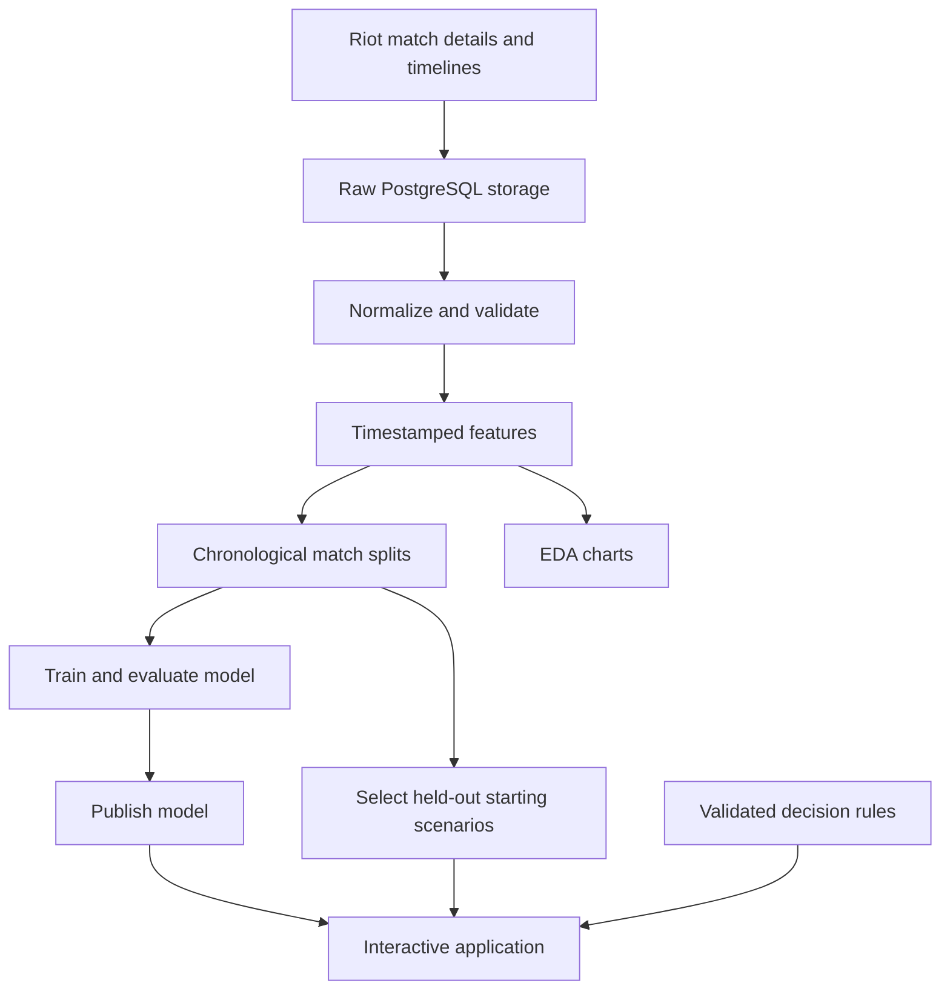

# Rift Decisions — LoL Winning Probability

Northwestern University · Topics in Data Engineering · Fall 2026

An interactive strategy simulation powered by a win-probability model trained on historical Riot match data.

## Project status

**Member A Week 8 implementation.** API ingestion, PostgreSQL storage, normalization, validation, offline rebuild and automated tests are implemented on this branch. Actual 100-match collection requires your Riot key and local seed players. Modeling, Airflow orchestration and gameplay remain in their assigned workstreams. See the [Member A runbook](docs/member_a_week8.md).

## Final deliverable

A player encounters an event, chooses an action, and receives a sampled success or failure. The simulator updates objectives, resources, and elapsed time. The trained model then estimates winning probability from the updated state, and an interactive Summoner's Rift map displays the result.

Start with one scenario containing three sequential decisions. Action-success probabilities are documented simulation assumptions; match-winning probabilities come from the historical-data-trained model. The simulation is for post-match exploration, not a live match feed or a causal estimate of strategy effectiveness.

## Data pipeline



Airflow will orchestrate ingestion through artifact publication, recording status, duration, record counts, and errors. The application calls the published model directly for each decision.

## Directory guide

| Path | Purpose | Owner |
| --- | --- | --- |
| `src/ingestion/` | API requests, pagination, retries, resumable collection | A |
| `src/storage/`, `sql/` | Database access, schema and migrations | A |
| `src/features/` | Timestamped game-state features | B |
| `src/modeling/` | Training, evaluation, inference | B |
| `src/game/`, `configs/scenarios/` | Decision rules, transitions, session state | C |
| `app/`, `assets/` | Interactive map and UI assets | D |
| `dags/` | Airflow orchestration; A/B supply their task functions | D |
| `data/raw/`, `data/processed/` | Local generated datasets, ignored by Git | A/B |
| `data/sample/` | Small reviewed offline fixtures, to be added | A |
| `models/` | Generated model artifacts, ignored by Git | B |
| `notebooks/`, `reports/` | Exploratory work, findings, final presentation | B/all |
| `tests/` | Component and integration tests | All |
| `scripts/` | Setup and operational entry points | All |
| `docs/` | Architecture, contracts, team schedule | All |

## Development setup

Use Python 3.11 as the initial team baseline. Run from the repository root:

```bash
git clone https://github.com/boxiongdu/lol-winning-probability.git
cd lol-winning-probability
git switch feature/data-ingestion
python3.11 -m venv .venv
source .venv/bin/activate
python -m pip install -r requirements.txt
cp .env.example .env
```

On Windows PowerShell activate with `.venv\\Scripts\\Activate.ps1` and copy with `Copy-Item .env.example .env`.

Start the local database and initialize the schema:

```bash
docker compose up -d --wait db
python -m src.ingestion init-db
```

For a synthetic offline smoke test in a demo database:

```bash
python -m src.ingestion load-fixture --directory data/sample
python -m src.ingestion rebuild
python -m src.ingestion status
```

For real collection use a clean database, set RIOT_API_KEY in .env, and copy
configs/seeds.example.json to configs/seeds.local.json with real seed players:

```bash
python -m src.ingestion collect --seeds configs/seeds.local.json --target 100
```

See the runbook for date filters, resume behavior, tests and expected counts.
The Compose file currently runs PostgreSQL only. Airflow and the game will be
added by the other workstreams.

Put your own Riot key in the local `.env`; never commit credentials. The CLI loads the repository `.env` without overriding exported environment variables. Development keys expire; collection stops clearly on authentication errors.

API reference: https://developer.riotgames.com/apis#match-v5

## Branch workflow

| Branch | Use |
| --- | --- |
| `main` | Stable, reviewed milestones |
| `dev` | Shared integration |
| `feature/data-ingestion` | Member A |
| `feature/modeling` | Member B |
| `feature/game-engine` | Member C |
| `feature/interactive-map` | Member D |

Start on your assigned feature branch. Open pull requests into `dev`, request a teammate review, and merge tested milestones from `dev` into `main`. These are team conventions; branch protection is not configured.

```bash
git fetch origin
git switch feature/data-ingestion
# Edit files, then stage only the intended changes.
git add path/to/changed_file
git commit -m "Describe the change"
git push -u origin feature/data-ingestion
```

Periodically merge `origin/dev` into your feature branch and resolve conflicts before opening a PR.

## Milestones

| Deadline | Acceptance checkpoint |
| --- | --- |
| Week 8 start | Shared schema, state fields, prediction interface, decision format |
| Week 8 end | One action resolves, updates state, predicts, displays, and logs |
| Week 9 midpoint | Three cumulative decisions; expanded data and evaluation |
| Week 9 end | Complete DAG, EDA, offline mode, fresh-clone test; feature freeze |
| Week 10 | Corrections, rehearsal, tagged repository, PowerPoint and backup demo |

See [team roles and weekly plan](docs/team_plan.md), [architecture](docs/architecture.md), and [data contract](docs/data_contract.md).

## Quality and reproducibility

- Deduplicate matches and resume failed ingestion.
- Save raw responses so transformations can be rerun without API calls.
- Build features only from information available at the selected timestamp.
- Keep all frames from a match in a single chronological split; exclude terminal states and outcome leakage.
- Evaluate against a baseline using Brier score, log loss, and calibration.
- Maintain every model input consistently in the simulator.
- Log actions, random draws, before/after states, predictions, and model/simulator versions.
- Deliver offline reproduction with reviewed sample data, versioned assets and dependencies.
- Archive a release snapshot: future API compatibility cannot be guaranteed.
- Each member supplies component tests, documentation, code review, and presentation slides.

## Attribution

Rift Decisions is not endorsed by Riot Games and does not reflect the views or opinions of Riot Games or anyone officially involved in producing or managing Riot Games properties. Riot Games and all associated properties are trademarks or registered trademarks of Riot Games, Inc.
