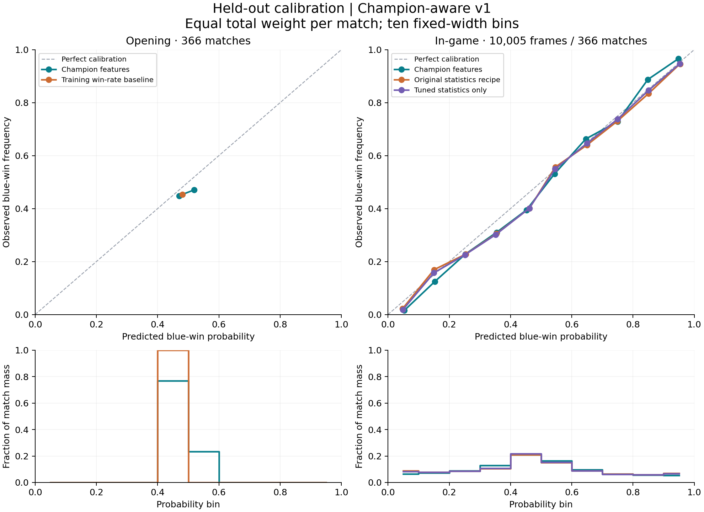

# Champion-aware models: final evaluation

**No demonstrated prediction gain from champion features in this experiment.**
Both interfaces are operational, but this is an experimental modeling handoff.
The opening model's small validation gain did not carry to test. The in-game
champion model scored worse than statistics-only on both validation and test.
There is no justified claim of reliable individual champion effects.

## Data and isolation

A's sample `4f67be78-4f12-4dc5-ae52-9a3760fcbf8b` contains 2443 selected and
normalized eligible matches, 173 observed champions, and 65,244 positive,
nonterminal snapshots. No selected IDs were missing or excluded. The collection
status remains `partial`; this report does not claim completion of roster quotas.

| Split | Whole matches | In-game snapshots | UTC start-date coverage |
| --- | ---: | ---: | --- |
| Training | 1710 | 45,386 | Nov 1–18, 2026 |
| Validation | 367 | 9,853 | Nov 18–22, 2026 |
| Test | 366 | 10,005 | Nov 22–26, 2026 |

Boundaries are strictly increasing exact start timestamps, including within-day
boundaries; see the manifest. Match IDs do not overlap. Only training data creates
the vocabulary, scalers and fitted weights. The selected parameters were frozen
before the final test evaluation. No post-test tuning was performed.

## Final test results

Lower is better. Each match has equal total evaluation weight. Opening has one
observation per match; in-game averages each match's snapshot losses first.
ECE uses ten equal-width probability bins with the same match weights.

| Stage/model | Brier | Log loss | ECE |
| --- | ---: | ---: | ---: |
| Opening: training win-rate baseline | 0.248612 | 0.690370 | 0.027735 |
| Opening: champion composition | 0.249056 | 0.691270 | 0.027837 |
| In-game: original statistics-only recipe, refitted | 0.182889 | 0.536404 | 0.028925 |
| In-game: validation-tuned statistics-only | 0.182801 | 0.536010 | 0.026016 |
| In-game: statistics + champion composition | 0.185394 | 0.542977 | 0.032719 |

## Validation results used for selection

| Stage/model | Selected C | Brier | Log loss |
| --- | ---: | ---: | ---: |
| Opening: win-rate baseline | — | 0.249585 | 0.692318 |
| Opening: champion composition | 0.01 | 0.249106 | 0.691366 |
| In-game: original statistics-only recipe | 1 (fixed) | 0.172503 | 0.512282 |
| In-game: tuned statistics-only | 0.01 | 0.172271 | 0.512014 |
| In-game: statistics + champion composition | 0.001 | 0.173033 | 0.515267 |

## Uncertainty and calibration

Paired whole-match bootstrap, 2000 repetitions. A negative delta favors champions.

| Test comparison | Brier delta [95% interval] | Log-loss delta [95% interval] |
| --- | --- | --- |
| Opening vs constant | +0.000444 [-0.002502, +0.003362] | +0.000901 [-0.005020, +0.006779] |
| In-game vs original statistics recipe | +0.002505 [-0.002416, +0.007511] | +0.006573 [-0.004908, +0.018746] |
| In-game vs tuned statistics | +0.002593 [-0.001969, +0.007307] | +0.006967 [-0.003607, +0.018267] |

All intervals include zero. This is insufficient evidence of an improvement;
it is also not a proof that champions can never help. Saved reliability tables
report bin counts, effective match mass, mean predicted probability and observed
win frequency, including explicit empty bins. No calibration transform was fitted
on test data. ECE depends on binning and finite sample size.

## Coverage and limits

The figure uses saved test bins, not refitted calibration curves. Only nonempty
bins are connected; it displays no confidence bands. Recreate it with
`python scripts/plot_champion_calibration.py` after installing matplotlib 3.10.8.

- All 173 observed champions occurred in training, so no held-out match contains
  a truly unseen ID. Unseen behavior is covered separately by automated tests.
- Nine champions have fewer than 20 training appearances (IDs 28, 33, 82, 113,
  223, 233, 360, 420, 895); warnings affect 18 validation and 25 test matches.
  Even frequent IDs can have unreliable coefficients because of roles, players,
  opponents, patches and sparse combinations.
- Training is mostly patches 16.21/16.22, with 29 early 16.23 matches. Test is later
  16.23 builds. This chronological patch shift is retained and reported, not
  removed after observing test performance.
- Sampling is based on a current Challenger roster on one server. It is not a
  random sample of all ranks or proof every participant was Challenger at play
  time. Whole-match splitting does not isolate repeated player identities.
- No features describe role, player strength, champion interactions or explicit
  patch effects. Coefficients must not be presented as causal bonuses.
- Simulated states may be outside the observational distribution. The opening
  to in-game switch can jump; states before 60 seconds are extrapolations and
  return warnings. This system does not estimate action-success probabilities.

## Reproducibility evidence

All held-out predictions replay through the production interface with maximum
absolute discrepancy **0.0**. Portable artifacts contain preprocessing, vocabulary,
feature order, selected parameters, metrics, exact split IDs, predictions,
environment/source hashes and checksums. The raw database and player identities
are excluded from the code release. See the [B handoff](../docs/member_b_champion_models.md)
for extraction, training and C/D example calls.

A second run of the same frozen protocol produced byte-identical models, encoder,
selection/evaluation metrics, split manifest and held-out predictions. Artifact
checksums and training source hashes were verified. The example also ran with
Python `-S`, proving inference does not require site packages.

Full-project verification: **80 passed, 9 skipped**. Eight existing PostgreSQL
integration tests were skipped because TEST_DATABASE_URL was not configured;
one existing Airflow test was skipped because Airflow was not installed. All
champion-model tests ran. Database export was not exercised against a live server;
the archive export was exercised on the full real backup.
